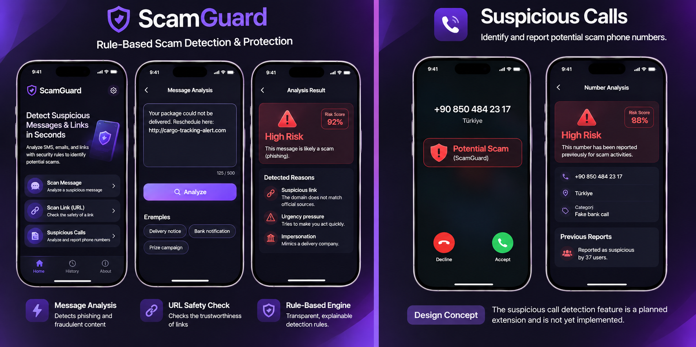

# ScamGuard

<p align="center">
  <strong>Detect Scams. Stay Safe.</strong><br/>
  Rule-based scam detection for suspicious messages and links.
</p>

<p align="center">
  
  
</p>

<p align="center">
  <em>Left: mobile app UI concept. Right: planned suspicious caller protection concept (not implemented).</em>
</p>

ScamGuard is a rule-based cybersecurity application designed to help users in Türkiye identify potentially fraudulent messages and suspicious links. It uses transparent security rules rather than AI-based classification.

## Features

- **Suspicious message scanning** — analyzes message text using rule-based detection.
- **URL analysis** — checks submitted links for potential threats.
- **Phone number reporting** — enables users to report suspicious phone numbers.
- **Threat intelligence integration** — synchronizes threat data from sources including USOM and URLhaus.
- **Domain information checks** — uses RDAP data to retrieve domain registration information.
- **Background jobs** — performs scheduled synchronization and maintenance tasks.

## Technology Stack

| Area | Technologies |
|---|---|
| Backend API | Python, FastAPI |
| Mobile and Web | Expo |
| Database | PostgreSQL 16 |
| Supporting Services | Redis 7 |
| Background Scheduling | APScheduler |
| Infrastructure | Docker Compose |
| Backend Testing | Pytest |
| Backend Linting and Formatting | Ruff |
| Mobile/Web Checks | ESLint, TypeScript |

## Architecture

The application is composed of the following services:

- **API** — FastAPI application that handles client requests.
- **Worker** — APScheduler-based service for threat intelligence synchronization and maintenance.
- **Database** — PostgreSQL for persistent application data.
- **Redis** — supporting service used by the application.
- **Client** — Expo application targeting mobile and web.

## Requirements

- Docker Desktop with Docker Compose v2
- Git
- Node.js 24 LTS (for the `mobile/` application)

## Getting Started

### 1. Clone the repository

```bash
git clone https://github.com/Damlayuksel/ScamGuard.git
cd ScamGuard
```

### 2. Configure environment variables

```bash
cp .env.example .env
```

Generate a secure secret:

```bash
python -c "import secrets; print(secrets.token_hex(32))"
```

Set the generated value as `SECRET_KEY` in your `.env` file.

### 3. Start the backend services

```bash
docker compose up -d --build
```

The development environment starts the API, background worker, PostgreSQL, and Redis services.

- API health endpoint: [http://localhost:8000/api/v1/health](http://localhost:8000/api/v1/health)
- Interactive API documentation: [http://localhost:8000/docs](http://localhost:8000/docs)

View API logs:

```bash
docker compose logs -f api
```

Stop the services:

```bash
docker compose down
```

### 4. Run the mobile and web application

In a separate terminal:

```bash
cd mobile
npm install
cp .env.example .env.local
npx expo start --web
```

Configure the backend URL in the local environment file as required by your development setup. The backend must be running before launching the client.

## Database Migrations

Apply database migrations with:

```bash
docker compose exec api alembic upgrade head
```

## Tests and Code Quality

Run backend tests:

```bash
docker compose exec api pytest
```

Run backend lint and formatting checks:

```bash
docker compose exec api ruff check .
docker compose exec api ruff format --check .
```

Run mobile and web checks from the `mobile/` directory:

```bash
npm run lint
npm run format:check
npm run typecheck
npm test
```

## Documentation

- [Project Guidelines](CLAUDE.md)
- [Project Guide](docs/PROJE_REHBERI.md)
- [Production and Deployment](infra/README.md)

## Planned Feature: Optional Human Review

For scan results that are suspicious or inconclusive, an optional human-review process is being considered as a premium feature. This functionality has not been implemented. Its design will require explicit user consent, privacy safeguards, reviewer access controls, and clear data retention and deletion procedures.

## Disclaimer

ScamGuard provides security indicators to help users assess potentially suspicious content. A scan result is not a guarantee that a message, URL, or phone number is safe or malicious. Users should exercise caution when interacting with unknown senders and links.

## License

No license has been specified yet.
